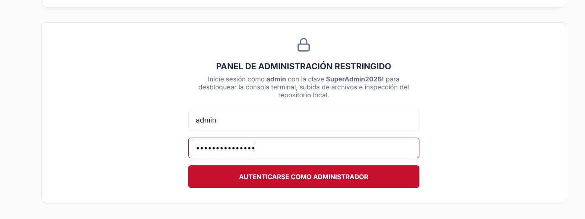
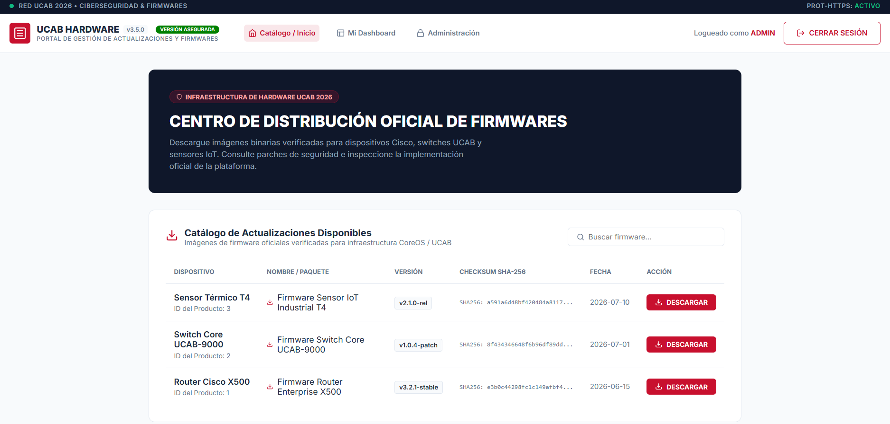
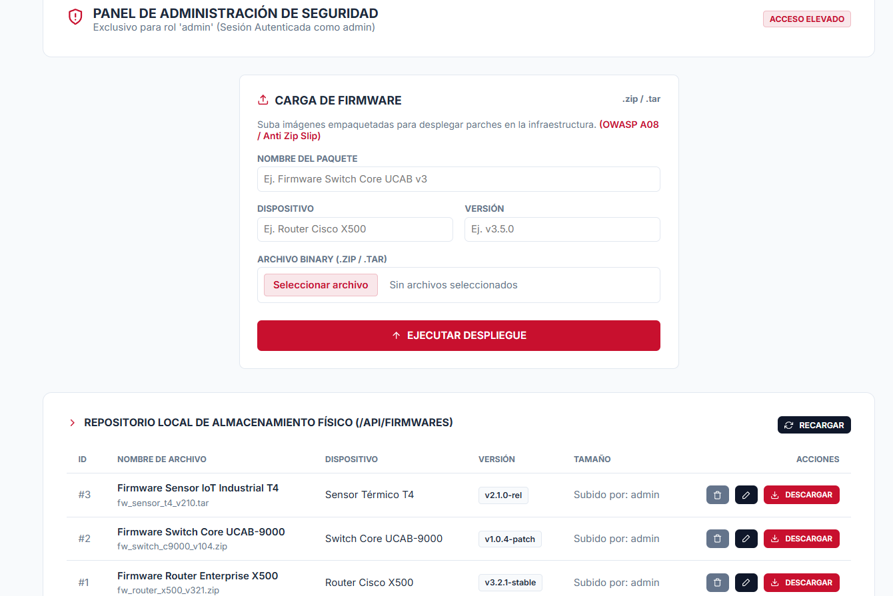

# 🛡️ Portal Seguro de Actualización de Firmware


Una plataforma web segura diseñada para gestionar y desplegar actualizaciones de firmware. Este proyecto demuestra la implementación práctica de mecanismos de ciberseguridad robustos para mitigar vulnerabilidades críticas del OWASP Top 10, centrándose específicamente en Fallas Criptográficas (A02) y Fallas de Integridad del Software y Datos (A08).

## ✨ Características Principales

- **Implementación Criptográfica a Medida:** Algoritmos PBKDF2 + HMAC escritos a mano para el hash de contraseñas (reemplazando al débil MD5), demostrando una comprensión profunda de las primitivas criptográficas.
- **Gestión de Sesiones a Prueba de Manipulaciones:** Tokens de autenticación firmados que previenen la falsificación y el escalado de privilegios.
- **Carga de Archivos Segura y Verificación de Integridad:** Validación estricta de los paquetes de firmware subidos (`.zip`/`.tar`) mediante firmas digitales para prevenir la Ejecución Remota de Código (RCE) y el despliegue de cargas maliciosas.
- **Control de Acceso Basado en Roles (RBAC):** Paneles de control y capacidades diferenciadas para operadores estándar y administradores.

## 🏗️ Arquitectura y Stack Tecnológico

- **Backend:** Python / Flask
- **Base de Datos:** SQLite (Almacenamiento ligero y sin servidor)
- **Frontend:** HTML, CSS, Plantillas Jinja2
- **Seguridad:** Uso nativo de `hashlib` y `hmac` en Python para operaciones criptográficas manuales (No se utilizaron librerías de autenticación de terceros para mostrar la mecánica de seguridad subyacente).

## 🚀 Empezando

### Requisitos Previos
- Python 3.8+

### Instalación y Ejecución (Windows / Linux)

```bash
git clone https://github.com/jesusobando32/Cyberseq.git
cd Cyberseq

# 1. Crea y activa un entorno virtual
python -m venv venv
# En Windows:
.\venv\Scripts\Activate.ps1
# En Linux:
source venv/bin/activate

# 2. Instala las dependencias
pip install -r requirements.txt

# 3. Variables de Entorno (.env)
# El proyecto utiliza un archivo .env para su configuración. Ya ha sido configurado para desarrollo local.
# Puedes copiar .env.example a .env y configurar tu propio PORTAL_SECRET si lo deseas.

# 4. Inicializa la base de datos y ejecuta el servidor
python init_db.py
python app.py
```
*Accede a la aplicación en `http://localhost:5000`.*

### Credenciales de Prueba
| Rol | Usuario | Contraseña |
|------|----------|----------|
| Usuario | `operador` | `operador123` |
| Admin| `admin` | `SuperAdmin2026!` |

## 🛡️ Postura Defensiva de Seguridad

Esta rama "asegurada" es resistente contra ataques comunes:
1. **Falsificación de Token de Admin:** Falla controladamente; el servidor rechaza cookies modificadas debido a firmas HMAC inválidas.
2. **Carga de Paquetes Maliciosos:** Falla; el servidor verifica la integridad y la firma antes de procesar cualquier archivo, previniendo la ejecución de código arbitrario.

## 📸 Galería de la Interfaz

### 1. Panel de Autenticación
Demostración de la UI de inicio de sesión seguro.


### 2. Catálogo y Dashboard Principal
Vista para usuarios autenticados con los firmwares disponibles.


### 3. Panel de Administración
Consola restringida para la carga segura de actualizaciones.

